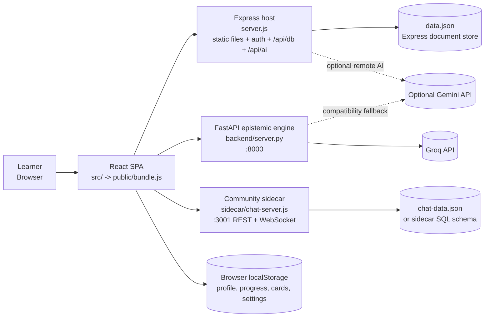
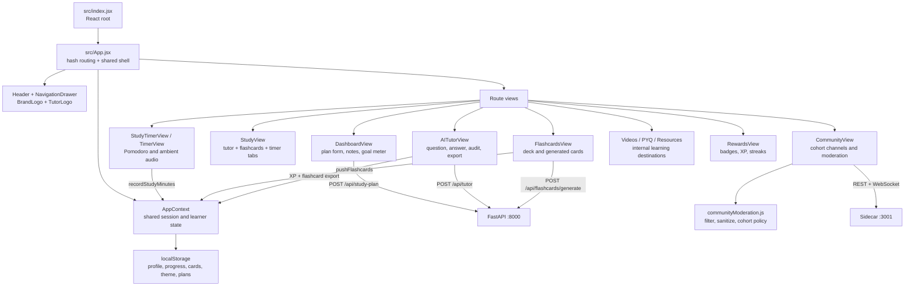
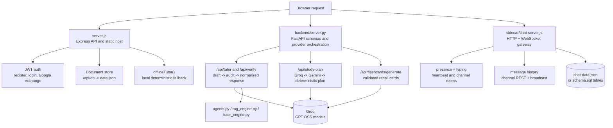
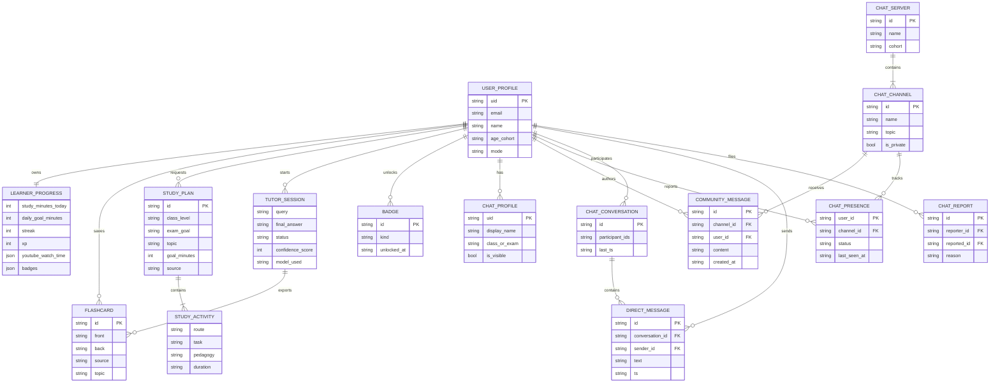
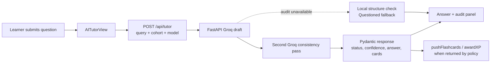
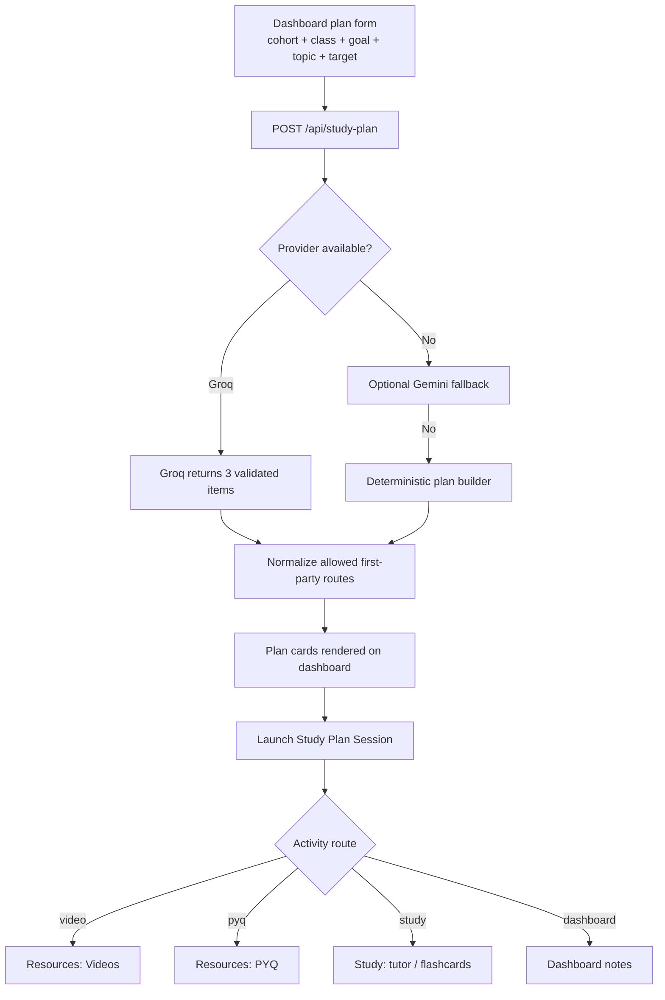
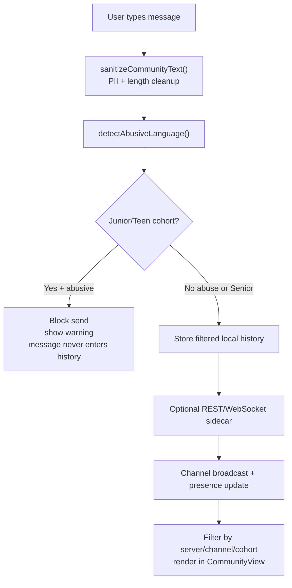

# EduNerd architecture overview

This document describes the running EduNerd system as it exists in this repository. The diagrams use Mermaid, so GitHub renders them directly in the repository view. The application is a browser SPA backed by three cooperating local services:

| Service | Responsibility | Local endpoint |
| --- | --- | --- |
| React SPA + Express host | UI, authentication, flat document storage, static assets, offline AI fallback | `http://localhost:3210` (or `PORT`, default `3000`) |
| FastAPI epistemic engine | Groq/Gemini tutor, consistency audit, study plans, flashcards | `http://localhost:8000` |
| Community sidecar | Channel REST endpoints, WebSocket chat, presence, and chat persistence | `http://localhost:3001` |

The browser keeps learner progress, preferences, and the local community history in `localStorage`. The Express server persists its document store in `data.json`; the sidecar uses `chat-data.json` locally and can be moved to the additive SQL schema in `sidecar/schema.sql` for a shared deployment.

## 1. System and deployment topology

**Boundary rule:** the browser never receives a provider secret. Groq and Gemini calls are made by the server processes, while the browser receives validated JSON responses or a deterministic offline response.

## 2. Frontend architecture

`AppContext` is the frontend state boundary. Views dispatch actions such as `recordStudyMinutes`, `pushFlashcards`, `awardXP`, and `resetTodayStudyProgress`; they do not maintain competing copies of progress. This keeps the dashboard meter, timer, YouTube watch-time tracking, streaks, and rewards derived from the same state.

## 3. Backend architecture

### Provider fallback order

1. **Tutor:** Groq draft, Groq second-pass audit, then a useful local `Questioned` answer if the audit is temporarily unavailable.
2. **Study plan:** Groq, then optional Gemini, then deterministic cohort/class/goal plan.
3. **Legacy `/api/ai`:** Gemini when configured, otherwise `offlineTutor()`.
4. **Community:** local React moderation always runs before a message is rendered; the sidecar remains an independent transport and persistence boundary.

## 4. Domain entity diagram

The entity diagram separates the learner domain from community chat. It is a conceptual model of the current JSON/localStorage records and the optional SQL sidecar tables, not a claim that the browser has a relational database today.

### Storage ownership

- `USER_PROFILE`, `LEARNER_PROGRESS`, `FLASHCARD`, `STUDY_PLAN`, and `BADGE` are currently serialized through `AppContext` into browser storage for local-first use.
- Authenticated Express users can also persist documents through `/api/db`, backed by `data.json` in this local deployment.
- `CHAT_CHANNEL`, `COMMUNITY_MESSAGE`, `CHAT_PRESENCE`, and related chat entities belong to the sidecar. The local sidecar uses JSON; `sidecar/schema.sql` defines the additive relational shape for a shared database.
- `TUTOR_SESSION` and provider responses are request-scoped. They are not automatically persisted unless the caller exports the result into progress, flashcards, notes, or community sharing.

## 5. End-to-end flow charts

### Tutor question and audited answer

### Study-plan generation and launch

### Community message safety and delivery

## 6. Important invariants

1. Provider keys stay in `.env` files read by Node or FastAPI; they are never embedded in `public/bundle.js`.
2. All AI routes return structured data before UI state is updated. The frontend can therefore preserve the existing answer/cards when a later audit or provider is unavailable.
3. Study-plan routes are allow-listed by the FastAPI response normalizer before the frontend navigates, preventing generated text from becoming an arbitrary external link.
4. Community moderation runs before local rendering for youth cohorts. Senior policy is intentionally different, but PII sanitization still applies.
5. `public/bundle.js` is generated from `src/index.jsx` by `build.js`; edit source modules, then rebuild.

## 7. Related source references

- [CODEBASE_GUIDE.md](CODEBASE_GUIDE.md) — maintained module catalog and connection notes.
- [server.js](server.js) — Express host, auth, document store, and offline AI route.
- [backend/server.py](backend/server.py) — FastAPI tutor, audit, flashcard, and study-plan routes.
- [sidecar/chat-server.js](sidecar/chat-server.js) — isolated community REST/WebSocket service.
- [sidecar/schema.sql](sidecar/schema.sql) — optional relational chat schema.
